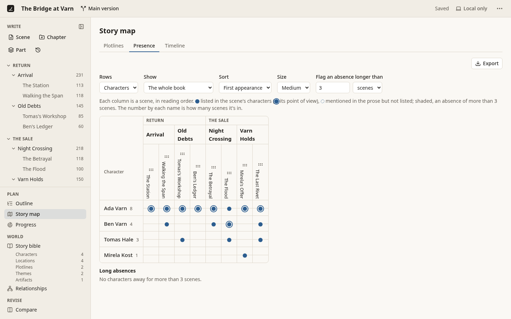
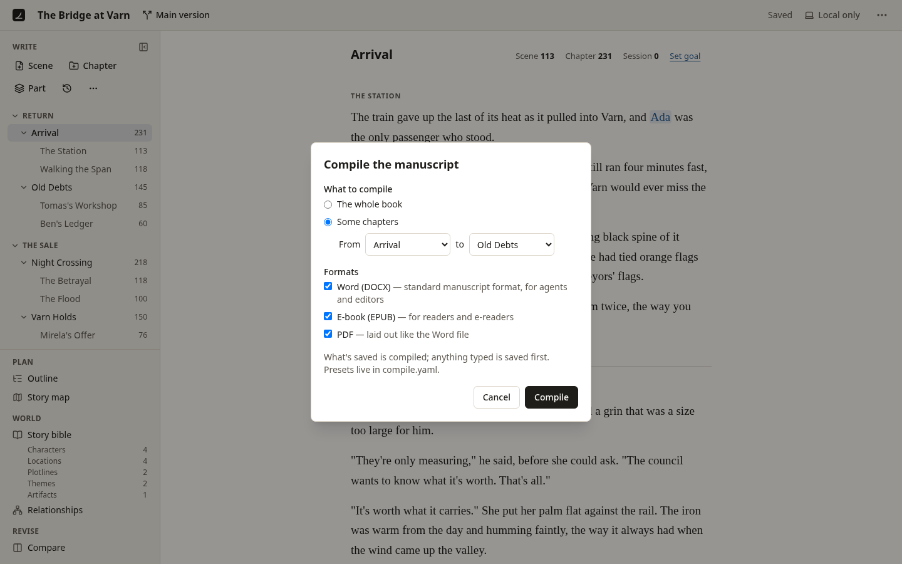
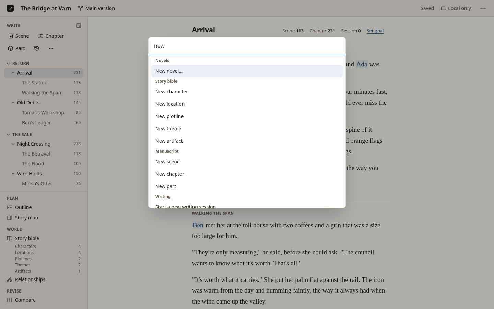

# gh-writer for writers

This guide is for the person writing the book. It assumes gh-writer is installed and running (see [Getting started](README.md#getting-started)). You don't need to know git or GitHub: gh-writer uses them for you, and this guide says what happens in plain terms.

**Contents:** [Your library](#your-library) · [Finding your way](#finding-your-way) · [Writing](#writing) · [Structure](#structure-parts-chapters-and-scenes) · [The story bible](#the-story-bible) · [Story map and relationships](#story-map-and-relationships) · [Progress](#progress) · [Saving and sync](#saving-and-sync) · [Drafts: versions and checkpoints](#drafts-versions-and-checkpoints) · [GitHub](#github) · [Issues](#issues) · [Compiling](#compiling) · [Keyboard](#keyboard) · [Your files](#your-files) · [The command line](#the-command-line)

## Your library

`npx gh-writer serve` opens your library in the browser: the novels on this computer, most recently opened first. From there:

- **New novel** starts one from the novel template, in `~/gh-writer/<title>` unless you choose another folder. The first time, gh-writer may ask who's writing: the name and email that sign your saved work.
- **Open a folder** adds a novel already on this computer.
- **Clone from GitHub** copies a novel from GitHub, after you've connected (see [GitHub](#github)), listing your repositories to choose from.

Each book stands on the shelf in a cover of its own design, or with your cover: its **⋯** menu has *Set a cover…* (and *Change the cover…*, *Remove the cover…*), as does the Compile dialog. A cover is framed like a [picture](#the-story-bible), at 5:8, and saved as `images/cover.jpg`, 1600 × 2560 px.

`npx gh-writer serve path/to/novel` opens one novel directly. Taking a novel out of the library leaves its folder alone.

### The desktop app

In the desktop app, the library has a window of its own, and each novel opens in a window of its own. Opening a novel that's already open brings its window forward. The logo at the top left, or *File › Your Novels*, brings back the library.

- **Choose…** beside a folder field opens your system's folder dialog, so you needn't type a path.
- **Drop a novel's folder** on the library window to open it, or open one from a terminal with `gh-writer path/to/novel`. If it isn't a novel, the library says why.
- **File › Open Recent** lists the novels you've opened most recently.
- **Right-click** (or **Shift+F10**, or the Menu key) anywhere for the app's own menu: **Back** and **Forward** everywhere, with **Cut**, **Copy**, **Paste** and **Select all** above them in text and in fields (and **Copy** elsewhere when text is selected). On a misspelled word the suggestions come first, and on selected text in a novel on GitHub, **Raise an issue…**; the manuscript tree keeps its own menu.
- **File › Use This Computer's git** switches from the git that comes with gh-writer to the one installed on your computer, if you'd rather use your own setup. Your open windows come back where they were.
- Quitting, or closing a window, saves what you've typed first.

## Finding your way

**The top bar** names the book and the version open (choose it to open [Drafts](#drafts-versions-and-checkpoints)), says whether your work is saved and synced, and keeps everything else in its **⋯** menu: Checkpoints, Compile, the theme (light, dark, or like your system), your GitHub account, and the keyboard shortcuts.

**The sidebar** groups everything by what you're doing:

- **Write**: the manuscript, as a tree of parts, chapters and scenes.
- **Plan**: the **Outline**, as a table, as cards or as a drafting board; the **Story map** (plotlines, presence and the timeline); the **Relationships** between entries; your **Notes**; your **Progress**; and the **Story bible**, with its entries and off-page events.
- **Revise**: **Compare** two drafts, and **Issues** for a novel on GitHub.

Collapse it to a strip of icons with the button at its top, or Ctrl+\\ (⌘\\ on a Mac); it stays that way until you open it again. **Focus mode** hides it, and the top bar, altogether.

## Writing

Choose a chapter or scene in the tree on the left. A chapter opens as one continuous text with each scene's title at its boundary; you can move between scenes freely, though typing can't merge or delete them by accident. The chapter's word count is beside its title, and the scene's is on its card in the right sidebar. The bar under the text has this session's words and **Today**: the words you've added today, against your daily goal if you've set one (it opens [Progress](#progress)).

- **Formatting:** Ctrl+I italic, Ctrl+B bold, Ctrl+Shift+B block quote, Ctrl+Enter section break, Shift+Enter line break. Typing Markdown works too: `*word*` for italic, `> ` for a quote, `***` for a break. (On a Mac, ⌘ for Ctrl throughout.)
- **Headings, lists and tables:** type `## ` at the start of a line for a heading (`#` to `###`), `- ` for a bulleted list, `1. ` for a numbered one; or Ctrl+Alt+1 to 3 for a heading (Ctrl+Alt+0 back to text), Ctrl+Shift+8 and Ctrl+Shift+7 for lists. In a list, Tab nests an item and Shift+Tab lifts it; Enter on an empty item leaves the list. *Insert table* in the command palette adds a table: Tab and Shift+Tab move between its cells, Tab in the last cell adds a row, and the palette's *Table:* commands add and delete rows and columns. A scene's headings sit beneath its chapter's title, so `#` is the largest a scene has. Anything else Markdown can do (code, footnotes, HTML) is kept as you wrote it, shown as Markdown.
- **Pictures:** drop or paste an image into the text, or choose *Insert a picture…* in the command palette, for a map, a letter's scan or a sketch between paragraphs. Give it a description (read aloud by screen readers in its place) and, if you like, a caption to show under it. It's resized to at most 1600 px on its longest edge and saved in the novel's `images/` folder, named from its description. To change the description or caption, select the picture (↑ or ↓ onto it, or click it) and press Enter, or double-click it; Drag it to move it: a line shows where it will land. Delete or Backspace removes it, and its file goes too unless something else shows it. Undo brings both back.
- **Focus mode** (Ctrl+Shift+F) hides everything but the text. **Typewriter scrolling** (Ctrl+Shift+L) keeps the line you're on steady on the screen.
- **Mentions:** type `@` and a few letters to mention someone or something from the story bible; ↑ ↓ and Enter to choose. A mention keeps its words in the text and stays linked if the entry is renamed. Hover over one, or press Alt+Enter beside it, for its card: who or what it is (with its picture, if it has one), and its relationships at this point in the story.
- **Quick entry:** under **New entry** at the bottom of the `@` list, *New character “Mira”*, *New location “Mira”* and so on create an entry named what you typed and mention it, without leaving the text. Fill in the rest later.
- **Spell check** knows the story bible's names. Ctrl+. (or a right-click) on an underlined word offers suggestions, **Add to dictionary** (the novel's own `dictionary.txt`) and **Ignore**.
- **Find** (Ctrl+F) searches the scene, chapter or whole manuscript; **Find and replace** (Ctrl+Shift+H) replaces across all of it, with one Undo.

### The right sidebar

Beside the text, the right sidebar has three tabs: **Scene**, **Notes** and **Entry**. **Ctrl+Shift+\\** (⌘⇧\\ on a Mac) hides and shows it; hidden, it's a strip of icons at the right edge. Drag its left edge to widen it (or focus that edge and use ← →). **F6** moves between the text and the sidebar, and **Escape** returns to the text with the caret where it was. Its tab, width and whether it's showing are remembered. On a narrow window it opens as a sheet over the text when you ask for it.

- **Scene** is a card for the scene the caret is in: its title and place in the chapter, the synopsis, the status (idea, outlined, drafted, revised, final) as five steps, and a row for each detail it has: point of view, where, characters, when (and for how long) in story time, plotlines with their weight and beat, entries of your own types, themes and tags. Details it hasn't got yet are under **Add…**. Each row's pencil edits it in place, with the people and places pickers (and *New character “…”* to make one as you go); Enter saves a single field and Escape or **Done** returns to the row. ◀ ▶ step through the chapter's scenes without moving the caret. **From the story** lists what the rest of the book says about the scene: the first or last scene, how long after the scene before it comes (or how far back a flashback goes), first appearances, someone back after a long absence, plotlines beginning or ending, relationships starting or ending.
- **Pins:** the pin on a row puts that detail under every scene's title in the text, as a quiet line (*Ada Varn · Day 1, 09:10 · 20 min*), sidebar showing or not. It's only shown, never written into your scene files.
- **Notes** are the notes on the scene the caret is in, as sticky-note cards: the one pinned here on top, then newest first, each a few lines until you open it. Open one (click, or Enter on its title) to write in it, change its title and tags, **Pin to the top** (the scene's other pinned note is unpinned), **Take off this scene**, or **Open the note** over the Notes gallery. **+ Note** (or *New note on this scene* in the palette) asks for a title, then puts the caret in the new note. A note can be on several scenes; it lists them, under a pencil, and **Add a note already written** on the tab puts one you've written on this scene too. Deleting a scene takes it off its notes, and asks whether notes on no other scene are kept or deleted.
- **Entry** shows a story bible entry: choose a name on the Scene card, or *Open entry* on a mention's card. It's the entry's profile at the sidebar's size, with its picture beside the name, read first and edited in place just as on its page, with its strip of scenes and its relationships read at the caret's scene, and *Open the full entry*. **Back** and **Forward** walk the entries you've opened, and whatever you open next shows there. The tab is called *Event* while it shows an off-page event. After a quick entry, the notice's **Add details** opens it with the name ready to edit.

## Structure: parts, chapters and scenes

The tree on the left holds the book. **New** adds a scene, a chapter or a part after the selection; F2 renames, Alt+↑ / Alt+↓ move, Delete deletes (deleted things wait in **Recently deleted**). You can drag in the tree, too. In the command palette, *Split the scene at the caret*, *Merge scene with the next* and *Move scene to chapter…* reshape scenes.

**Outline** shows every scene in reading order, three ways; switch with **Table**, **Cards** and **Board** at its top, and it remembers which you like:

- **Table**: each scene's synopsis, status, point of view, characters, plotlines and word count; edit the synopsis and status in place, and drag to reorder.
- **Cards**: scenes as index cards by chapter, filtered by point of view, character, plotline or status; drag cards to reorder.
- **Board**: your drafting progress, a column for each status (Idea, Outlined, Drafted, Revised, Final) with its scenes and words. Drag a card to another column, or press Alt+← / Alt+→ on its handle, to change a scene's status. Filter by point of view, part or chapter. For a novel on GitHub, the board can be on GitHub too (see [The board on GitHub](#the-board-on-github)).


## The story bible

**Story bible** in the left panel opens a gallery of every entry, grouped by type: characters, locations, plotlines, themes and any types of your own (an "Artifacts" type in the sample novel, say). Each card shows its picture (a portrait beside the name, or the initials while there's none; a place's picture across the top, or *No picture yet*), the summary, a fact or two, a small strip of the scenes the entry is in and how many; an entry no scene uses yet says *Not in the story yet*. Search by name or other name, and sort by first appearance, name or most scenes.

An entry opens over the gallery, like a card picked up off the table, as a profile to read first. Each part has a pencil (or *+ Add…* while it's empty) and edits in place: the name, other names (recognised when you type `@`), tags, the summary, fields of your choice (*+ Add a field*; rename or remove one from its pencil) and the notes, which you write in straight away. Enter saves, and so does moving on: clicking or tabbing elsewhere, opening another part, or closing the entry. Escape leaves a part as it was. Close the entry with ✕, Escape or a click outside it, back to the gallery as you left it; everything is already saved. Wherever you open an entry from (the palette, a mention's card, a link), it opens over the gallery, and **Back** closes it.

**New entry** (or **New** on a type's group, or *New character* and so on in the palette) opens a new one with just its name, and its type when you haven't chosen one: type the name and press Enter or move on, and the rest of its profile appears in place. Closed without a name, nothing is made.

**Pictures.** Beside the name is a slot for a picture: a portrait for a character or an entry of your own types, a wide picture for a place. Drop an image on it, paste one while it has the focus, or click it to choose one. Then frame it: drag the frame, or move it with the arrow keys (Shift moves it further, + and − make it smaller and larger, as does *Size*), and put the dot where cards and thumbnails should centre the picture, such as a face. The dialog says what it will save: the file in the novel's `images/` folder (named after the entry, like `images/ada-varn.jpg`), its size in pixels and about how large it is. Pictures are resized as they're added (a portrait to 1200 × 1500 px, a place to 1600 × 900), so every copy of the book stays quick to sync; the original isn't kept. Its pencil *Change…*, *Recrop…* or *Remove…* it; each is one change in the history, and no old file is left behind. Images over 100 MB, GitHub's limit, are refused.

Below them:

- **In the story**: every scene in reading order, under its part and chapter names, marked where the entry carries the scene (a character's point of view, a plotline's major beat, a theme at its strongest), is in it, or is only mentioned. Each mark opens its scene. Beneath it: first and last appearance, how many scenes, the longest absence, and the off-page events it's part of.
- **By type**: a location's visitors and the story time its scenes span; a plotline's beats in reading order, with *+ Write the beat* where a scene hasn't said what happens (written into that scene), the scenes it skips, who's in it and where; a theme's strength scene by scene.
- **Relationships** as arcs over the same scenes: each from the scene it starts to the scene it ends, in its kind's colour and line, with its name on the bar. The marker under them (arrow keys, or a click) reads what holds at one scene. A bar opens *Change at…*, *End at…* and *Remove…*; *+ Add a relationship* makes a new one.

The kinds of relationship are listed at the end of the gallery. **Edit** one to rename it or choose its colour, from the eight of the app's chart palette (each readable in light and dark, and for colour-blind readers), and its line: solid, dashed or dotted. A new kind takes a colour no other kind uses, so adding one never repaints the rest; the same colours are used in the graph, the arcs, the cards and the diagrams on github.com. Off-page events, like a flood years before the story starts, live on the story map's **Timeline**.


## Story map and relationships

The **Story map** sets the story's elements against its scenes, in three tabs (←/→ move between them):

- **Plotlines**: a row per plotline, a column per scene, with major and minor beats; stretches where a plotline goes quiet too long are shaded and listed.
- **Presence**: which characters (or themes) are in which scenes.
- **Timeline**: the book in story time, joined by lines to reading order, so flashbacks stand out; and anyone who is in two places at once is listed. A scene or event happens on a day of the story (Day 1, Day -100) or on a date. **Day 1 is…** at the top says which date Day 1 is, so the two share one timeline: type a date, or choose a dated scene to take its date (copied once; moving the scene later leaves Day 1 where it was). Day 0 is the day before Day 1. Until Day 1 has a date, the days can't be placed among the dates and come after them, and the Timeline says how many there are. Moving a scene or event from a day to a date offers to make that date its day, which dates Day 1 for you.

### Off-page events

Off-page events are what happens in the story's world but isn't shown: backstory, things between scenes. They're cards in the **Story bible**, in their own group after the entries, in story-time order. Add one with **New** there, **New off-page event** on the Timeline, or from the palette (*Off the page:* opens one); a mention's card opens one beside the text on the right sidebar. The outline's table and cards have an **Order** switch: in *Story time*, the scenes come in the order things happen, with the events among them, dashed and marked *Off the page* (nothing is dragged there: reading order is what you rearrange). Each opens over the Story bible, read first like an entry's, made from just its title the same way, and saved as you go: when it happens and for how long, who, where and its plotlines, each with a pencil to edit in place, and its note, written as prose with @ mentions. *In story time* says which scenes it falls between. A new title renames its file; **Delete** asks first if the story mentions it. When an event earns its place on the page, **Write it as a scene** makes a new scene at the end of the chapter you choose, with the event's time, people, places and plotlines, and its note as the synopsis. The event is kept, noting the scene that dramatizes it (the scene's card says so too), or removed, unless the story mentions it.

Events show wherever the story's facts do. Type @ in prose to mention one (they're listed under *Off the page*, after the bible's entries); its card shows when it happens, who and where, and opens it beside the text. A scene's card says when an event comes right before or after it in story time ("6 days after the off-page event “The plans are stolen”"), and an entry's profile links to the events it's part of.

Each event is a file of its own, `bible/events/<title>.md`. A novel made before that kept them all in `bible/events.yaml`: the first time you change an event, gh-writer asks to move the novel to the new format, in one commit. Copies of gh-writer from before then won't open it afterwards.

### Notes

Notes are your own thinking, kept with the book: ideas, what-ifs, questions to answer later. **New note** (in the palette or on the Notes page) makes one, and *Note:* in the palette opens one. A note opens over the Notes gallery, and a new one starts as just its title: press Enter or move on and the caret goes into its text, ready to write. Close it with ✕, Escape or a click outside it; everything is already saved, and a new note closed without a title isn't made. A note has a title, tags and prose, each edited in place, and the prose takes @ mentions like a scene's. **Notes**, under Plan, shows every note as a card, with its tags and scenes, filtered by a tag or words and sorted newest or by title. The Story bible shows off-page events the same way, as their own group of cards after the entries. An entry or an event lists the notes that mention it, under *In your notes*. Notes are never part of the manuscript, the compile or the Story map. When one earns its place in the story, **Make it an event or a scene** turns it into an off-page event (the note as its note) or a new scene at the end of a chapter (the note as its synopsis), and keeps the note, saying what it became, or removes it. Each note is a file of its own, `notes/<title>.md`.

**Relationships**, under Plan, draws the story bible's relationships as a graph. Drag the *Story position* slider, or press **Play**, to see relationships begin and end as the story goes. Arrange entries by dragging; the layout is saved.

Each has an **Export** button for SVG; the relationships and the timeline also export Mermaid.



## Progress

**Progress** (under Plan) shows how the book is coming along, worked out from its history, so it's the same on every computer and nothing has to be logged:

- **The book's length** against your target, and where you're heading: the words to go, the day you'd finish at your pace over the last four weeks, and how that stands against your deadline (with the words a day that would meet it).
- **Written today**, against your daily goal; your **streak** of days meeting it, and your best; your **pace**; the projected **finish**.
- **Words per day**: what you added and what you cut, over the last 30 or 90 days or all of it. Revising shows here as cuts; it doesn't count against your daily goal, which is about words added.
- **Length of the book** over time, toward the target.
- **Chapters and their scenes**: each chapter's length divided into its scenes, with the ones unusually long or short named (over half again the median, or under half of it), to spot an unbalanced stretch.

Set the **target length**, the **date** to reach it by and your **words a day** at the bottom of the page; they're kept with the book in `novel.yaml`. Each chart has *As a table* for the same numbers, and the arrow keys read it day by day (or scene by scene).


## Saving and sync

**Saving is automatic.** The top bar says *Saved*, *Saving…* or *Unsaved*; typed words are kept even if the app or the browser closes unexpectedly. If a file you're editing changes somewhere else (another computer, or a text editor), gh-writer shows both versions side by side so you choose what to keep.

**Sync**: with a novel on GitHub, gh-writer brings in changes and sends yours every few minutes, and when you choose *Sync now*. The top bar shows whether you're synced. If the same passage was changed in two places, *Resolve sync conflicts* walks you through each one.


### Your name and email

git signs every change it saves to your book's history with a name and an email, and needs both before it can save anything. If you're signed in to GitHub, gh-writer offers your account's name and its private noreply address. GitHub knows that address is you, and your own email stays out of the history. You can change them any time under *Your name and email…* in the **⋯** menu. They're set for every novel on this computer, as git's own settings (`git config --global`). If saved work is waiting because git doesn't know you yet, the sync button says so and offers to fix it.
## Drafts: versions and checkpoints

**Drafts** (the version's name in the top bar, or *Checkpoints* in the ⋯ menu) holds the book's history:

- A **version** is a separate take on the book that lives alongside the main one: a darker ending, the book without a subplot. It has its own text and story bible; the main version stays exactly as it was.
- A **checkpoint** is a named moment in a version, like "Before the big cut", to come back to.

Drafts lists the version open now first, with *New checkpoint* and its checkpoints; then the other versions, each with its own checkpoints; then any you've discarded.


**Checkpoints.** Make one in the version you're in. Later, **Restore manuscript** brings the whole manuscript and story bible back as they were then, or **Restore “scene”** just the scene you're in; **Compare with now** shows what has changed since. A restore first takes a checkpoint of its own, so it can always be undone. Restoring a checkpoint from another version brings that version's text into the one open, and Drafts asks first. gh-writer also takes checkpoints by itself before anything it changes for you (a restore, adopting a version); tick *Show the checkpoints gh-writer made* to see them.

**Versions.**

- **Start one** under *Start a new version*: name it and choose *Start version*. It begins as a copy of the version you're in, and opens. Everything you write now goes into it.
- **Open** another version from Drafts, or with *Open version: …* in the command palette. What you've typed is saved first. If the chapter you're in doesn't exist in the other version, the book opens at its start.
- **Compare** shows exactly what's different (see below).
- **Adopt into main** when the version is the one you want: the main version opens and takes the version's changes. Anything you changed in the main version since the version began is kept too; where both changed the same passage, you choose, side by side, as with sync conflicts. The main version is kept in a checkpoint first, so *Undo* puts it back.
- **Bring single scenes across** instead, from the compare view: *Use this scene from “…”* copies that scene's text and details into the version you're in.
- **Discard** a version you don't want. It's kept first, under *Discarded versions* in Drafts; *Bring it back* there (or in the notice) restores it.

With a novel on GitHub, versions sync like everything else, so your other computers have them too. Discarding one removes it there at the next sync.

**Compare** (under Revise, in the command palette, and in Drafts) sets any two of *now*, a version and a checkpoint side by side. It lists every chapter and scene that changed, with word counts before and after; open a scene to read its text with deleted words struck through and new words underlined, so a reworded sentence shows just the words that changed. Changes to a scene's details (status, point of view, characters…), the story bible, relationships and off-page events are listed too. Untick *Only what changed* to see the whole book.


## GitHub

**Connect GitHub…** in the ⋯ menu signs you in: gh-writer shows a code to enter on github.com. If you already use GitHub's `gh` command, you can sign in with that instead. Your sign-in stays in your computer's keychain.

A novel that's only on this computer says **Local only** in the top bar; choose it to **put it on GitHub** as a new private or public repository. From then on it syncs, and the GitHub features below appear; for a local-only novel they stay out of the way.

On github.com, the novel's repository shows the book as files, keeps every version, and runs a few automatic workflows: **Validate** checks the files on every push, **Diagrams** redraws the diagram snapshots into `diagrams/`, and **Compile** makes a Release for each named checkpoint (see [Compiling](#compiling)).

### The board on GitHub

On the **Board**, **Put this board on GitHub** makes a GitHub project for the novel, linked to its repository: every scene a card, with its status, point of view, part, chapter, words and place in the book. GitHub shows it as a board, a table or a roadmap, on github.com and in GitHub's phone app; choose the layout there (for a board, *Board* in the view's menu, grouped by Status).

- **Status goes both ways.** Move a card to another column on GitHub and the scene's status changes here at the next sync, as if you'd changed it yourself. Change it here and the card moves there.
- **Everything else comes from your novel.** Change a card's point of view, chapter or words on GitHub and gh-writer puts it back, and says so above the board. Cards you add yourself on GitHub are left alone.
- **When both changed.** If a scene's status was changed here and on GitHub, to different things, before they synced, neither is overwritten: the board lists the scene with both statuses, and you choose **Keep** yours or **Use GitHub's**. A computer that has never synced the board before treats every difference this way.
- **When.** The board syncs with each sync with GitHub, and with **Sync board now**. It follows the main version: while another version is open, it waits.
- **Nothing to lose.** Your novel's files are what count. Delete the project on GitHub and nothing in the novel changes; the board says so and offers to make a new one.
- If you signed in before the board existed, GitHub may ask you to **reconnect** once, to let gh-writer use Projects.

## Issues

Issues are for the work around the book: plot holes, continuity errors, research questions, ideas and revision notes. (Story facts belong in the story bible.) They're GitHub issues, so you can also see and edit them on github.com.

- **Issues** in the views lists them, with search and filters for state, kind, label and milestone. **New issue** creates one; **Milestones** organises them (e.g. "Second draft").
- **Kinds** (plot hole, continuity, research, idea, revision) are labels with colours.
- **Labels for the story**: every character, plotline and theme has a label (`character/ada-varn`), so you can filter for everything about Ada.
- **About a passage**: select some text and right-click, or use *Raise an issue about the selection…*. The issue quotes the passage and gets labels for the people and places in the scene. A marker in the margin shows which paragraphs have issues; choose it to read and comment beside the text.
- **Offline**, changes wait and are sent when GitHub can be reached again.

## Compiling

**Compile…** in the ⋯ menu (or *Compile the manuscript…* in the command palette) makes the book into files to share:

- **Word (DOCX)** in standard manuscript format, for agents and editors: a title page with your contact details and word count, Times New Roman 12 pt double-spaced, a running header, chapters on new pages, "THE END".
- **E-book (EPUB)** for readers and e-readers.
- **PDF**, laid out like the Word file.

A scene's headings, lists, tables and pictures come out as themselves in all three, set beneath the chapter's heading. Compile the whole book or a range of chapters. Anything you've just typed is saved first. The **Cover** row shows the book's cover, if it has one, with *Change…* and *Remove* (or *Add a cover…*): it's the e-book's cover and the PDF's first page, and Word manuscripts go out without one, as agents expect. Presets in a `compile.yaml` file in the novel set the title page details, chapter headings ("Chapter Four: The Flood", or just the number or title), the scene break marker, and front and back matter such as a dedication; see the [format spec](docs/format/v2.md#compileyaml).

**On GitHub**, every named checkpoint you make becomes a Release of the novel's repository with the three files attached, and *Actions → Compile → Run workflow* compiles on demand. The files are identical to the app's for the same saved version.

> **A novel started before compiling existed** doesn't have the Compile workflow yet. [Upgrading a novel's tools](docs/format/v2.md#upgrading-a-novels-tools) says which files to copy in from the template.



## Keyboard

Everything is reachable from the keyboard. **Ctrl+K** opens the command palette, which can do anything in the app: go to a chapter or scene, open a view, make a checkpoint, sync, change the theme. **Back** and **Forward** in the top bar, or **Alt+←** and **Alt+→** (outside text, where those keys move the caret), go back and forward through the pages you've visited, as do the mouse's back and forward buttons. **Ctrl+/** lists the keyboard shortcuts, **Ctrl+\\** collapses or expands the sidebar, and **Ctrl+Shift+\\** hides or shows the right sidebar; **F6** moves between it and the text.



## Your files

A novel is a folder of plain files you can read and edit anywhere: on github.com, in a text editor, or by hand.

```
novel.yaml           title, author, word target, kinds of relationship
compile.yaml         compile presets (optional)
dictionary.txt       words the spell checker accepts
manuscript/          parts, chapters (folders) and scenes (Markdown files)
bible/               one file per character, location, plotline, theme…
bible/relationships.yaml
bible/events/        off-page events, one file each
notes/               your notes, one file each (not part of the story)
diagrams/            generated diagram snapshots
```

Write each paragraph on one line, and don't change the IDs (`char_7f3k2q`). The novel's own README explains more, and the [format spec](docs/format/v2.md) says everything.

The format has a version, `schema_version` in `novel.yaml`. A newer gh-writer may move a novel to a newer format (it asks first). An older copy, on another computer say, then won't open the novel: it says to update gh-writer rather than show it wrongly or save over it. Syncing still works.

## The command line

From the gh-writer folder:

| Command | Does |
|---|---|
| `npx gh-writer serve [dir]` | Start the app; with a folder, open that novel. `--port`, `--no-open`, `--sync-every <minutes>` |
| `npx gh-writer validate [dir]` | Check a novel's files for broken references and other problems |
| `npx gh-writer snapshots [dir]` | Redraw the diagram snapshots in `diagrams/` |
| `npx gh-writer compile [dir]` | Compile to `compiled/` in the novel. `--format docx,epub,pdf`, `--preset`, `--from`/`--to` (chapter IDs), `--out` |
| `npx gh-writer migrate [dir]` | Move a novel to the newest format as one commit, and update its tools in `.github/gh-writer/` ([format spec](docs/format/v2.md#versioning)) |
| `npx gh-writer new-id <prefix>` | A new ID, for editing files by hand |

In a novel's own folder, without gh-writer installed, the same tools run as `node .github/gh-writer/validate.mjs`, `snapshots.mjs` and `compile.mjs`.
